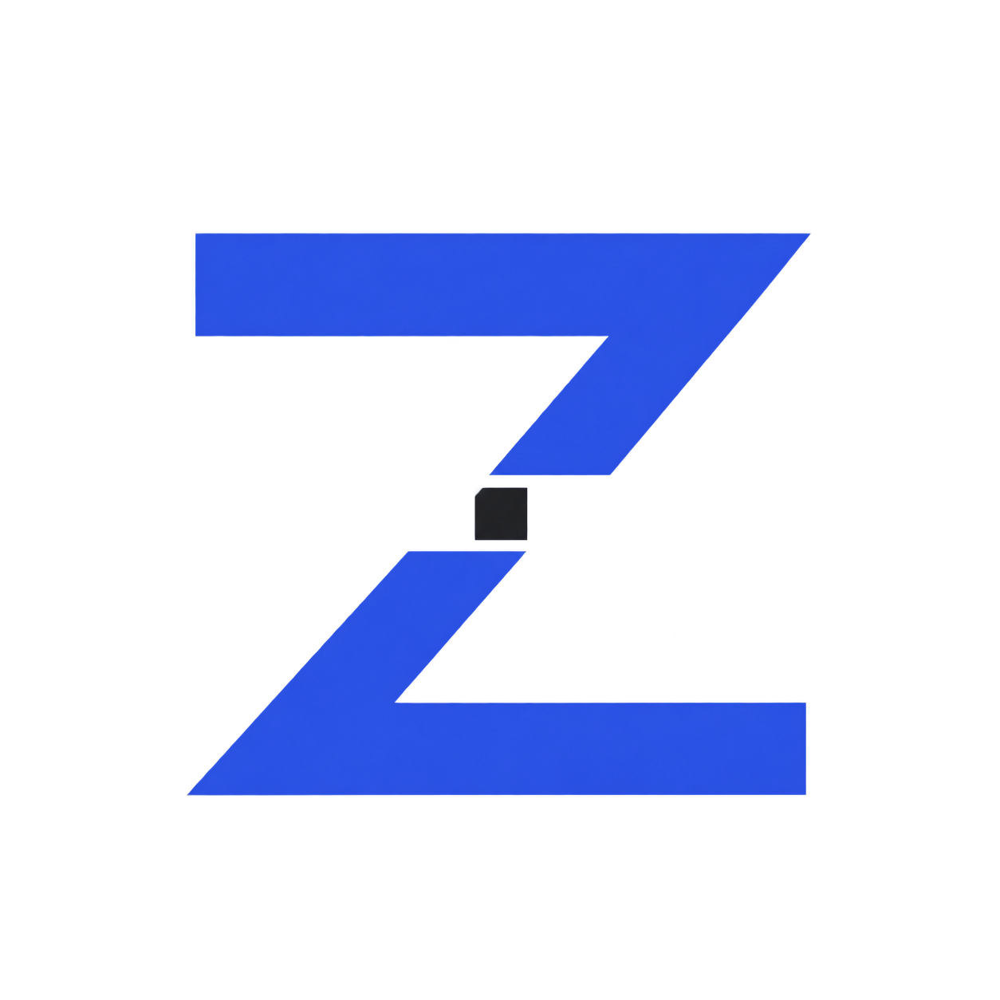
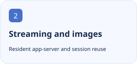
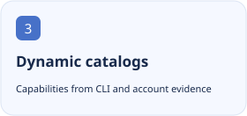

<p align="center"></p>

<h1 align="center">ZCode Plan Bridge</h1>

<p align="center">Run DSH model requests through your signed-in ZCode CLI, with real streaming, image input and account-derived model catalogs.</p>

<p align="center">[简体中文](README.md) · [English](README.en.md)</p>

[](https://github.com/tangyixiao/dsh-zcode-plan-bridge/stargazers) [](https://github.com/tangyixiao/dsh-zcode-plan-bridge/actions/workflows/check.yml) [](LICENSE) [](https://www.npmjs.com/package/dsh-zcode-plan-bridge)

<p align="center">
  <picture><source media="(prefers-color-scheme: dark)" srcset="docs/assets/feature-1-en-dark.svg"></picture>
  <picture><source media="(prefers-color-scheme: dark)" srcset="docs/assets/feature-2-en-dark.svg"></picture>
  <picture><source media="(prefers-color-scheme: dark)" srcset="docs/assets/feature-3-en-dark.svg"></picture>
</p>

## Get started

Desktop: install the release `.tgz` through Extensions → Plugin Management → Add Plugin. For a Web profile you explicitly control:

```sh
dsh plugin --profile web add dsh-zcode-plan-bridge@0.6.0
```

Sign in through ZCode CLI, then select the ZCode CLI provider in DSH. Set `accountMode: start-plan` explicitly for that channel; a billing error alone does not mean a top-up is needed.

## Status and compatibility

| Item | Current source of truth |
| --- | --- |
| Source version | `0.6.0` · 以 [package.json](package.json) 为准 |
| Distribution | `npm` · [Releases](https://github.com/tangyixiao/dsh-zcode-plan-bridge/releases) |
| DSH | `>=0.1.5 <0.3.0-0 \|\| ^0.1.5-rc.1 \|\| ^0.1.7-rc.1 \|\| ^0.2.0-rc.1 \|\| ^0.2.1-rc.1 \|\| 0.2.2-rc.1` |
| Node.js | `>=22` |
| Development | [Open issues](https://github.com/tangyixiao/dsh-zcode-plan-bridge/issues?q=is%3Aissue+is%3Aopen) · [CI](https://github.com/tangyixiao/dsh-zcode-plan-bridge/actions) |

A readable catalog, a loaded plugin and successful inference are separate facts. Preserve an existing `0.6.0-community.*` preview installation rather than replacing it with a stable channel.

[Native Retry guide](community/README.md)

## Development and participation

```sh
npm ci --ignore-scripts
npm test
npm run typecheck
node tools/check-repository.mjs
```

[Contributing](CONTRIBUTING.md) · [Support](SUPPORT.md) · [Questions](https://github.com/tangyixiao/dsh-zcode-plan-bridge/discussions) · [Report a bug](https://github.com/tangyixiao/dsh-zcode-plan-bridge/issues/new/choose) · [Security](SECURITY.md) · [Maintenance](docs/maintenance.md)

## Star History

<picture><source media="(prefers-color-scheme: dark)" srcset="https://api.star-history.com/chart?repos=tangyixiao/dsh-zcode-plan-bridge&amp;type=date&amp;theme=dark&amp;legend=top-left"></picture>

[Interactive chart](https://www.star-history.com/?repos=tangyixiao%2Fdsh-zcode-plan-bridge&type=date) · [GitHub Stars](https://github.com/tangyixiao/dsh-zcode-plan-bridge/stargazers)

The external chart uses real star records and may be cached or unavailable; no development percentage is inferred.

## Origin and licenses

[Software license](LICENSE) · [Logo artwork and attribution](assets/NOTICE.md)

Software retains its existing license. Whale-girl derivative artwork is separately CC BY-NC-SA 4.0 with the attribution chain for 上善, ZipZipPipe and Small-tailqwq.

Derived from [kyle123740/dsh-zcode-cli-proxy](https://github.com/kyle123740/dsh-zcode-cli-proxy), under AGPL-3.0.
